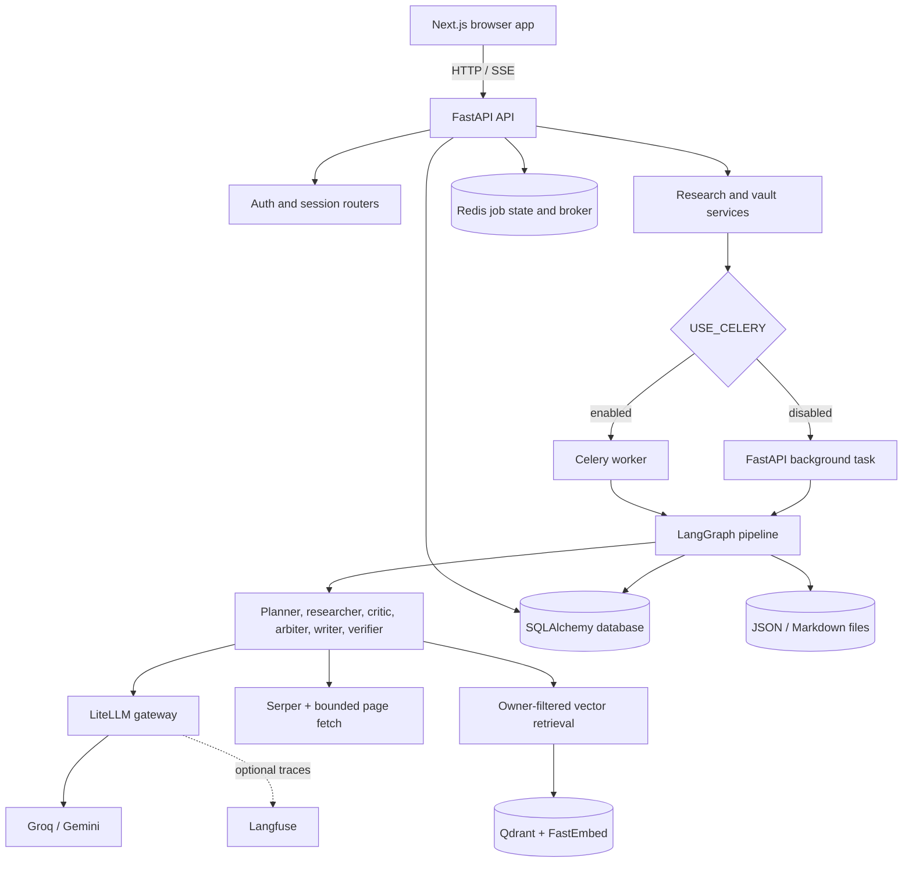
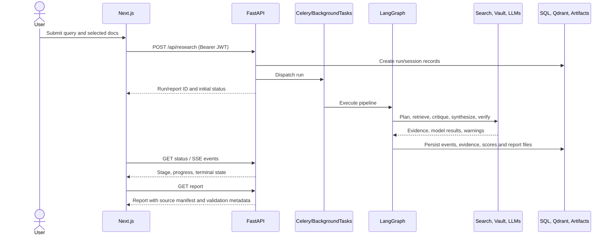
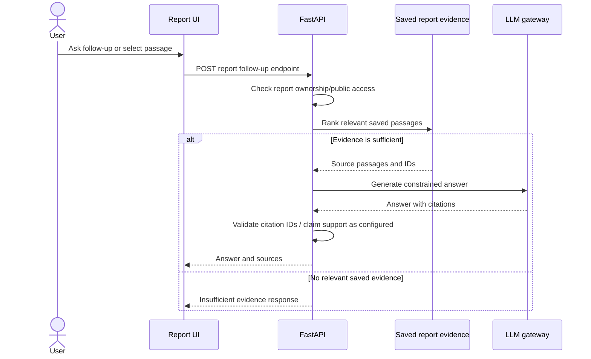

# Ada Research Agent

Ada is a personal research workspace that turns a question into a source-grounded research report. It combines web search, a user's private document vault, a multi-stage agent pipeline, citation checks, and report follow-up grounded in the saved evidence. This manual describes the implementation in this repository; it does not imply service-level guarantees or independently validated research accuracy.

## Contents

1. [Executive Summary](#1-executive-summary)
2. [Architecture Overview](#2-architecture-overview)
3. [Project Structure](#3-project-structure)
4. [Core Features & Subsystems](#4-core-features--subsystems)
5. [Service Layer Documentation](#5-service-layer-documentation)
6. [API Documentation](#6-api-documentation)
7. [Configuration Reference](#7-configuration-reference)
8. [Deployment & Setup Guide](#8-deployment--setup-guide)
9. [Workflow Diagrams](#9-workflow-diagrams)
10. [Troubleshooting Guide](#10-troubleshooting-guide)

## 1. Executive Summary

### Problem and product

Research across web pages and personal documents is difficult to reproduce and audit. Ada accepts a research question, decomposes it into tracks, gathers evidence, reviews coverage and contradictions, writes a structured report, and retains the evidence manifest so citations and follow-up questions can be inspected.

### Technical philosophy

- **Evidence first:** synthesis receives retrieved evidence with stable source IDs; citation guards check references against that manifest.
- **Explicit run lifecycle:** status, stage, progress, events, and persisted artifacts represent a run's progress and outcome.
- **Bounded agent behavior:** run token and cost budgets, provider rate limiting, timeouts, fallback models, cancellation checks, and a finite critic/arbiter loop bound work.
- **Private by default:** vault retrieval is filtered by owner; reports require ownership unless explicitly shared.
- **Inspectable, optional telemetry:** Langfuse tracing is opt-in. When enabled, it receives prompts and model outputs; handle it as sensitive research data.

### Stack

| Layer | Implementation |
|---|---|
| Web application | Next.js App Router, React, TypeScript, Tailwind CSS |
| HTTP API | FastAPI, Pydantic, SQLAlchemy, bearer JWT |
| Agent orchestration | LangGraph state graph; LiteLLM model gateway |
| Search and ingestion | Serper search, bounded web retrieval, PyMuPDF, standard-library DOCX/CSV parsing |
| Vector retrieval | Qdrant with FastEmbed `BAAI/bge-small-en-v1.5` (384 dimensions) |
| Async jobs and events | Celery + Redis when enabled; FastAPI background tasks and in-process event fallback for local mode |
| Persistence | SQLite by default; PostgreSQL URL support; Qdrant for vectors; filesystem artifacts |
| Operations | Docker Compose, Caddy, optional Langfuse SDK instrumentation |

## 2. Architecture Overview



### Separation of concerns

| Tier | Responsibility |
|---|---|
| API (`engine/server.py`, `engine/auth.py`, `engine/sessions.py`) | HTTP validation, authentication, dispatch, and error translation for report, vault, run, and session operations. |
| Service/domain (`engine/graph/`, `engine/agents/`, `engine/workers/`, `engine/tasks.py`) | Research lifecycle, planning, retrieval, evidence review, synthesis, verification, and follow-up behavior. |
| Persistence (`engine/database.py`, `engine/models.py`, `engine/storage/`) | Relational entities, Qdrant documents, per-run records, and durable artifact references. |
| Integrations (`packages/llm_gateway/`, `engine/ingest/`) | Model routing, rate limits, cache, provider calls, web search/fetch, document parsing, embeddings. |
| Presentation (`frontend/src/`) | Login, research workspace, vault, run/report views, history, settings, and architecture visualization. |

The current implementation is a modular monolith with a separately runnable worker, rather than independently deployed domain services. SQL stores identity and run/report metadata; local report files and uploaded documents are also required for some workflows. Compose currently defaults to SQLite, which is suitable for local development and single-host deployments, but is not a high-availability database configuration.

## 3. Project Structure

```text
.
├── engine/
│   ├── agents/             # Planning, critique, synthesis, claim checks, follow-up and memory
│   ├── export/             # Markdown / HTML report export
│   ├── evaluation/         # Offline claim-support metrics and dataset validation
│   ├── graph/              # LangGraph state, nodes, routing and compiled pipeline
│   ├── guards/             # Citation and evidence grounding
│   ├── ingest/             # PDF, DOCX, CSV, text, web retrieval and chunking
│   ├── storage/            # Relational repository, dossier mapping and Qdrant vector store
│   ├── services/           # Research-run, preflight, report, session and vault use cases
│   ├── schemas/            # API request and response DTOs
│   ├── workers/            # Search and per-track research execution
│   ├── auth.py             # Registration, login, JWT and password reset
│   ├── celery_app.py       # Queue configuration and job-state storage
│   ├── database.py         # SQLAlchemy engine/session lifecycle
│   ├── events.py           # Run event publication and SSE generator
│   ├── models.py           # SQLAlchemy entities
│   ├── server.py           # FastAPI application and research/report/vault endpoints
│   ├── sessions.py         # Session and turn endpoints
│   └── tasks.py            # Sync pipeline entry point and Celery task
├── packages/llm_gateway/   # Model groups, LiteLLM client, cache, limiter and trace IDs
├── evals/                  # Versioned synthetic claim-support smoke dataset
├── frontend/src/
│   ├── app/                # Next.js routes and global styles
│   ├── components/         # Shared UI plus focused run and vault panels
│   ├── context/            # Client authentication state
│   ├── hooks/              # Research launch, follow-up, event-stream and vault workflows
│   └── lib/                # API DTOs, report transforms, run helpers and config
├── scripts/                # Offline evaluation / operational scripts
├── tests/                  # Unit and workflow tests
├── Dockerfile              # Backend/worker image
├── docker-compose.yml      # Caddy, frontend, backend, worker, Redis and Qdrant
├── Caddyfile               # Reverse proxy and static frontend routing
├── requirements.txt        # Python dependencies
└── README.md
```

| Package/module | Responsibility and key interface |
|---|---|
| `engine.server` | FastAPI routes; validates inputs and checks private resource access before reads/writes. |
| `engine.services.research_runs` | Creates owned sessions/turns, tracks live jobs, dispatches workers, and resolves cancellation/status fallbacks. |
| `engine.services.preflight` | Resolves only the user's selected private documents before query scoping. |
| `engine.services.report_followups` | Answers from saved evidence, verifies citations, and persists focused addenda. |
| `engine.services.reports` / `engine.services.sessions` / `engine.services.vault` | Own report access/history/sharing, session ownership and lifecycle, and private document operations. |
| `engine.services.errors` | Provides transport-independent service errors; each use case keeps a domain-specific subtype. |
| `engine.schemas` | Defines the Pydantic request/response contracts used by API routes. |
| `engine.graph.pipeline` | Creates the LangGraph and seeds `RunState`; `execute_graph_pipeline(...)` returns final state. |
| `engine.graph.nodes` | Implements scope, plan, research, critic, arbitration, outline, section synthesis, assembly, verification, scoring, finalization. |
| `engine.tasks` | Runs the graph, normalizes evidence, persists lifecycle and artifacts; Celery task entry point. |
| `engine.workers.research_worker` | Executes search/research for individual tracks and iterative research rounds. |
| `engine.agents` | Agent prompts and domain logic: planning, critique, structured writing, claim verification, relevance and report follow-up. |
| `engine.guards.citation_guard` | Extracts citations and removes/flags references absent from the retrieved manifest. |
| `engine.ingest.doc_processor` | Converts supported documents into text chunks with page/heading/section metadata. |
| `engine.storage.vector_store` | Embeds and filters vault chunks in Qdrant; each private chunk must have `user_id`. |
| `engine.storage.relational_store` | Persists normalized run, evidence, finding, score, LLM call and event records. |
| `engine.storage.run_dossier` | Maps loaded relational records into the report and run-inspector response shape. |
| `engine.models` / `engine.database` | Relational schema and SQLAlchemy lifecycle. |
| `engine.events` / `engine.celery_app` | Event streaming and asynchronous job state. |
| `packages.llm_gateway` | Provider model groups, failover, rate limiting, response cache, structured parsing, usage and optional tracing. |
| `frontend/src/app` | Page routes: home/studio, dashboard, history, vault, report, run, session, settings, login/register/reset, architecture. |
| `frontend/src/hooks` | Owns cohesive client workflows: research preflight/launch, evidence follow-ups, run event streaming and vault operations. |
| `frontend/src/lib/report-content.ts` | Shares report chapter parsing, citation lookup and source merging across report UI. |

## 4. Core Features & Subsystems

### 4.1 Research graph

`RunState` carries the run ID, query/settings, brief, research plan, track status, evidence manifest, critic findings, iteration counters, outline, generated sections, report, guard results, scores, artifacts, and warnings. The compiled graph in `engine/graph/pipeline.py` follows this path:

```text
scope → plan → research → [critic → optional arbiter → critic] → outline
      → synthesize_sections → assemble → verify → score → finalize
```

The graph checks cancellation at stage boundaries. Deep runs can use two research rounds; non-deep runs use one. Critic routing and arbitration are conditional, and the graph terminates when its route selects `END`.

```python
final_state = execute_graph_pipeline(
    query="Compare approaches to ...",
    depth="deep",
    include_user_docs=True,
    report_id=run_id,
    selected_docs=["research-notes.pdf"],
    user_id=user_id,
)
```

The actual function accepts optional `custom_angles`, `clarification_choice`, and `blocked_domains` as well. It returns the final state dictionary. Provider or retrieval failures are represented in warnings, status, or agent results depending on the stage; callers should inspect final status and errors rather than assume every run produced a complete report.

### 4.2 Research planning and evidence collection

The planner converts the question and optional user angles into research tracks/search queries. Track workers query Serper when configured, exclude social/profile pages from default evidence, prioritize stronger domains, fetch candidate pages through the bounded scraper, and may use search-result snippets when a page cannot be fetched. Selected private documents are retrieved from Qdrant with owner filtering, so the upload owner is part of the retrieval boundary. Evidence normalization assigns stable web IDs (`S1...`) and document IDs (`D1...`) and merges duplicates, including matching NASA press-release headlines, while retaining associated track IDs.

Document ingestion supports PDF, DOCX, CSV and pasted text. PDF extraction retains page information; chunking uses detected headings/section boundaries and overlap for long units. Chunk boundaries are retrieval units, not a promise to reproduce every source document's semantic outline exactly. Reindexing reprocesses a stored upload and replaces its indexed chunks.

### 4.3 Evidence critique, synthesis and citation checks

The critic identifies coverage gaps and contradictory evidence. The arbiter can add bounded follow-up queries, then the critic receives another pass. The sectional synthesizer creates an outline, assigns evidence IDs to sections, generates sections and assembles Markdown. Citation validation checks `[S#]` and `[D#]` references against the run's manifest; claim verification separately judges whether cited passages support extracted claims. These checks reduce unsupported references but do not prove the overall factual correctness of a report.

### 4.4 Report follow-up

Follow-up questions rank the report's saved evidence and generate an answer from relevant passages. The endpoint does not silently expand into a new web search when the report has no relevant saved evidence; callers receive an insufficiency response. A source-specific question is restricted to the selected source. Addenda can launch a focused investigation using the request and saved report context.

### 4.5 LLM gateway and observability

`LLMClient` routes calls by `small`, `large`, `write`, or `judge` model group; applies a token-bucket limiter; checks a deterministic response cache; retries a rate-limit response once; uses the configured fallback model on failure; and attempts one structured-output repair call when a Pydantic schema is supplied. `LLMResult` reports content, parsed data, model/group, token usage, latency, estimated cost, cache hit, degraded status and error.

Langfuse instrumentation lives at two explicit boundaries: the optional SDK creates a root observation for each research graph invocation, and Ada's LLM gateway creates a child generation for each uncached provider attempt. Both use the same Langfuse client and active trace context, so model inputs, outputs, token usage, and provider failures remain attached to the research run without relying on LiteLLM's separate OpenTelemetry callback lifecycle. The SDK flushes the completed trace when the run ends. Search, fetch, vault retrieval, and UI lifecycle events remain visible in Ada's run inspector rather than being duplicated into Langfuse. The local runner is separate from Ada's deployment Compose stack, which does not receive Langfuse credentials. Traces can contain research prompts and model outputs, so keep the Langfuse instance and keys local and use only a project whose retention/access settings are appropriate.

### 4.6 Authentication, privacy and persistence

The API issues a seven-day HS256 bearer JWT. User-owned sessions and vault documents are filtered by authenticated user. Reports are private by default and are exposed publicly only through the explicit toggle endpoint. Some legacy report records are still represented by `ResearchTurn`; newer normalized run entities use `Run` and related tables. Report JSON/Markdown artifacts live on disk, so deployments must persist and back up database, uploads, dossiers, and Qdrant data consistently.

## 5. Service Layer Documentation

### Research orchestration

- `engine.services.research_runs.ResearchRunService.start(...)` validates the run command, verifies selected-document/session ownership, creates the durable session turn, registers initial state and dispatches the worker.
- `engine.tasks.run_research_pipeline_sync(...)` invokes the LangGraph and returns a normalized result shape. Individual graph nodes persist evidence, scores and report artifacts through their adapters.
- `engine.tasks.run_research_pipeline_task(...)` owns the worker terminal transition. It accepts completion only when report Markdown exists and the durable turn is present, commits the turn before publishing live completion, and rolls back before attempting to persist failure after an exception.
- Worker failures are fully logged server-side and exposed to the UI as a safe summary. This avoids leaking provider or database exception details into run status/events.
- Celery delivery and distributed result state depend on Redis and `USE_CELERY`; local mode dispatches through FastAPI background tasks.
- `engine.graph.pipeline.build_research_graph() -> CompiledGraph` registers nodes and conditional edges. A reusable graph is compiled at module import.
- `execute_graph_pipeline(...) -> Dict[str, Any]` constructs initial typed state and invokes the compiled graph. Input is the query and run configuration; failures from graph nodes can propagate unless a node handles them.

### Frontend workflow boundaries

| Hook or component | Responsibility |
|---|---|
| `useResearchLaunch` | Snapshots the selected query/depth/domain/vault scope, performs preflight and recalibration, prevents duplicate dispatch and routes to the new run. |
| `useRunEventStream` | Owns SSE connection, event parsing, reconnects with backoff and resumes from the last event ID; durable-status polling keeps terminal state accurate while reconnecting. |
| `useReportFollowups` | Sends evidence-scoped questions, owns answer/loading state and aborts a request when its report view is left. |
| `useVaultLibrary` | Owns source list, upload/paste/reindex/delete and preview request state. |
| Dashboard/studio resource state | Keys private history and vault results by the current auth token and aborts stale requests on navigation or identity changes. |

### Integrations and data access

- `LLMClient.complete(...) -> LLMResult` is the model boundary. Inputs include model group, messages, optional Pydantic schema, generation limits, run ID and agent label. Provider failures return a degraded result with an error after fallback exhaustion; limiter/setup failures can still raise.
- `AdaVectorStore.index_document_chunks(...) -> int` embeds and upserts private chunks, rejecting chunks without an owner. Search methods apply user filters; Qdrant/model initialization failures raise rather than silently creating an empty in-memory store.
- `RelationalStore` encapsulates writes and queries for normalized run entities. Methods generally open and close their own SQLAlchemy session; callers should not share ORM instances across independent sessions without reloading them.
- `get_db()` yields a request-scoped SQLAlchemy session and closes it after the dependency scope. `init_db()` creates tables defined by the models; schema evolution is not a substitute for a migration system.
- `publish_event(...)` writes a run event and broadcasts to active SSE listeners, using Redis when reachable and a local in-process queue fallback where supported.

### Error handling conventions

Request shape errors are validated by Pydantic. Expected application failures derive from `engine.services.errors.ServiceError`, carry an HTTP status and safe detail, and are translated at the API boundary; run, report, follow-up, preflight and vault services use named subtypes. Missing or inaccessible private resources generally return 404 to avoid disclosing existence. The LLM boundary returns `LLMResult.error` for provider failures; persistent-store initialization raises a chained `RuntimeError`; worker failures are logged with detail but returned to clients as a safe summary. Optional status/event persistence still uses best-effort exception handling in some graph helpers, so the primary research run may continue while telemetry/progress persistence is incomplete. Treat this distinction as part of the operational contract.

## 6. API Documentation

All paths below are relative to the backend origin (default `http://localhost:8000`). JSON endpoints use JSON bodies unless marked multipart or SSE. Authenticated endpoints require `Authorization: Bearer <token>`. DTO names describe the Pydantic request classes; response bodies are the dictionaries/models returned by the current handlers. FastAPI's generated OpenAPI document at `/docs` is the authoritative schema for a running revision.

### Authentication and sessions

| Method and path | Request | Success response | Common statuses |
|---|---|---|---|
| `POST /api/auth/register` | `{email, username, password}` (`username` 3–50 chars, password 6–128) | `{token, user:{id,email,username,created_at,stats}}` | 200; 400 duplicate/invalid username; 422 validation |
| `POST /api/auth/login` | `{login, password}` | Same auth DTO | 200; 401 invalid credentials; 422 |
| `GET /api/auth/me` | Bearer token | `{id,email,username,created_at,stats}` | 200; 401 |
| `POST /api/auth/change-password` | `{current_password,new_password}` + bearer | `{status:"ok",message}` | 200; 400 incorrect current password; 401 |
| `POST /api/auth/forgot-password` | `{login}` | Generic `{status:"ok",message}` whether account exists or not | 200; reset delivery requires SMTP settings |
| `POST /api/auth/reset-password` | `{token,new_password}` | `{status:"ok",message}` | 200; 400 invalid/expired token; 404 deleted user |
| `GET /api/sessions` | Bearer token | `{sessions:[...]}` | 200; 401 |
| `POST /api/sessions` | `{title}` + bearer | `{id,title,created_at}` | 200; 401/422 |
| `GET /api/sessions/{session_id}` | Optional bearer | Session metadata plus `turns` array | 200; 404 private/missing |
| `PATCH /api/sessions/{session_id}` | `{title}` + bearer | `{status:"ok",id,title}` | 200; 404; 422 |
| `DELETE /api/sessions/{session_id}` | Bearer token | `{status:"ok",message}` | 200; 404 |
| `DELETE /api/sessions/{session_id}/turns/{turn_id}` | Bearer token | `{status:"ok",message}` | 200; 404 |
| `GET /api/sessions/{session_id}/export` | Optional bearer | `{session_id,title,markdown}` | 200; 404 private/missing |

### Research and reports

| Method and path | Request | Success response / behavior | Common statuses |
|---|---|---|---|
| `GET /health` | None | `{status:"ok"}` | 200 |
| `POST /api/research/preflight` | `{query,depth="deep",include_user_docs=true,selected_docs?,user_modification?}` | Scope/preflight assessment and clarifying information | 200; 401 where protected; 422 |
| `POST /api/research` | `{query,depth="deep",include_user_docs=true,selected_docs?,clarification_choice?,custom_angles?,session_id?,blocked_domains?}` + bearer | Accepted run/report identifier and initial lifecycle metadata; processing continues asynchronously | 200; 401/404/422; 503 if dispatch unavailable |
| `POST /api/research/{report_id}/cancel` | Bearer token | Latest known run state after cancellation is requested | 200; 404 private/missing |
| `GET /api/report/status/{report_id}` | Optional bearer | Job state including status, stage, progress and error as available | 200; 404 private/missing |
| `GET /api/v1/runs/{report_id}/report` | Optional bearer | Persisted report JSON; legacy artifacts are read when present | 200; 404 private/missing/unavailable |
| `GET /api/v1/runs/{run_id}` | Optional bearer | Normalized run metadata | 200; 404 |
| `GET /api/v1/runs/{run_id}/events` | Optional bearer; SSE stream | `text/event-stream` run events | 200 stream; 404/authorization response |
| `GET /api/reports` | Bearer token | User's report listing | 200; 401 |
| `POST /api/report/{report_id}/toggle-public` | Bearer token | Updated public-sharing state | 200; 404 |
| `GET /api/report/{report_id}/download/{fmt}` | Optional bearer; `fmt` selects supported export format | File response | 200; 404/422 |

### Evidence follow-up

| Method and path | Request | Success response / behavior | Common statuses |
|---|---|---|---|
| `POST /api/report/{report_id}/query-evidence` | `{question,selected_text?}` | Evidence-grounded follow-up; may report insufficient saved evidence | 200; 404; 422 |
| `POST /api/report/{report_id}/addendum` | `{inquiry,selected_text?,context?}` | Starts a focused addendum investigation | 200; 404; 422 |
| `POST /api/report/{report_id}/query-source` | `{source_id,question}` | Answer constrained to one report source | 200; 404; 422 |

### Vault and document ingestion

| Method and path | Request | Success response / behavior | Common statuses |
|---|---|---|---|
| `POST /api/upload` | Multipart file upload + bearer | Stores supported document, processes and indexes chunks | 200; 400 unsupported/invalid; 401; 413 too large; 422 |
| `POST /api/paste-document` | `{title,text}` + bearer | Stores and indexes pasted text | 200; 401; 422 |
| `GET /api/vault` | Bearer token | Current user's documents and indexing status | 200; 401 |
| `DELETE /api/vault/{doc_name}` | Bearer token | Deletes user's source and associated indexed chunks | 200; 404; 401 |
| `POST /api/vault/{doc_name}/reindex` | Bearer token | Reprocesses and reindexes stored document | 200; 404; 422 on processing failure |
| `GET /api/vault/{doc_name}/preview` | Bearer token | Document preview metadata/content | 200; 404; 401 |

The server currently limits uploads to 20 MiB and limits each user to 20 stored documents. Consult route code/OpenAPI for exact response fields, upload MIME constraints, and format values because these may evolve independently of this prose.

## 7. Configuration Reference

Root `.env` is loaded by `engine/config.py`; Docker Compose also interpolates root environment values. Keep secrets in `.env` or a deployment secret manager; never commit live keys.

| Variable | Default | Purpose / notes |
|---|---|---|
| `GROQ_API_KEY` | empty | Groq model provider credential. |
| `GEMINI_API_KEY` | empty | Gemini model provider credential. |
| `SERPER_API_KEY` | empty | Web search provider; search breadth is reduced/unavailable without it. |
| `LLM_SMALL_PRIMARY` / `LLM_SMALL_FALLBACK` | `groq/qwen/qwen3.8-27b` / `gemini/gemini-flash-latest` | Lightweight planning/judgment group. |
| `LLM_LARGE_PRIMARY` / `LLM_LARGE_FALLBACK` | `groq/openai/gpt-oss-120b` / `gemini/gemini-flash-latest` | Larger reasoning group. |
| `LLM_WRITE_PRIMARY` / `LLM_WRITE_FALLBACK` | `gemini/gemini-flash-latest` / `groq/openai/gpt-oss-120b` | Report writing group. |
| `LLM_JUDGE_PRIMARY` / `LLM_JUDGE_FALLBACK` | `groq/qwen/qwen3.8-27b` / `gemini/gemini-flash-latest` | Claim/relevance evaluation group. |
| `LLM_DEFAULT_RPM` | `60` | Default request rate limit. |
| `LLM_DEFAULT_TPM` | `100000` | Default estimated token rate limit. |
| `RUN_COST_BUDGET_USD` | `5.0` | Stops starting new model calls after recorded run cost reaches this amount. An in-flight provider call can finish above the limit. |
| `RUN_TOKEN_BUDGET` | `250000` | Stops starting a model call when recorded usage plus its requested output allowance would exceed the limit. |
| `MAX_SEARCHES_PER_RUN` | `30` | Maximum search-provider requests reserved by one research run. |
| `MAX_FETCHES_PER_RUN` | `20` | Maximum page-fetch operations reserved across parallel tracks. |
| `RUN_TIME_BUDGET_SECONDS` | `900` | Run deadline after which no new model request or search/page fetch starts; a request already in flight may finish before the run can stop. |
| `RESEARCH_CONCURRENCY` | `3` | Maximum parallel research tracks in one run. |
| `DATABASE_URL` | SQLite file under repository root | SQLAlchemy URL; PostgreSQL is supported. Compose defaults to `/app/data/ada.db`. |
| `JWT_SECRET` | ephemeral in development; required in production | HS256 signing secret. Local ephemeral key invalidates sessions after restart. |
| `APP_ENV` | `development` | `production` makes missing `JWT_SECRET` a startup error. |
| `REDIS_URL` | `redis://localhost:6379/0` | Celery broker and shared job-state backend. Compose uses `redis://redis:6379/0`. |
| `USE_CELERY` | `false` | `true` selects Celery dispatch; local mode uses background tasks and fallbacks. Compose sets true. |
| `QDRANT_URL` | empty | Remote Qdrant URL. Empty uses local persisted path `qdrant_data`. |
| `QDRANT_API_KEY` | empty | Optional Qdrant Cloud/service key. |
| `LANGFUSE_ENABLED` | `false` | Opt-in Langfuse traces for research runs and model generations; requires both Langfuse keys. |
| `LANGFUSE_PUBLIC_KEY` / `LANGFUSE_SECRET_KEY` | empty | Langfuse project credentials. Treat prompts/results as sensitive data. |
| `LANGFUSE_BASE_URL` | `http://localhost:3002` | Optional Langfuse server URL. Deployment Compose does not pass it to Ada containers. |
| `PUBLIC_APP_URL` | `http://localhost:3000` in sample | Base URL for password-reset links. |
| `SMTP_HOST` / `SMTP_PORT` | empty / `587` | SMTP transport for reset email. |
| `SMTP_USER` / `SMTP_PASSWORD` | empty | Optional SMTP authentication credentials. |
| `SMTP_FROM` | empty | Sender address; required with host and public URL to deliver reset links. |
| `DOMAIN_NAME` | `:80` | Caddy site address; set a domain for automatic HTTPS. |
| `NEXT_PUBLIC_API_URL` | derived by frontend | Override API origin. Local browser defaults to `http://localhost:8000`; non-local uses same origin. |

Hard-coded integration constants include model defaults, the embedding model, the Qdrant collection, and the seven-day JWT expiry; they are not environment variables in this revision.

## 8. Deployment & Setup Guide

### Local development without Docker

Prerequisites: Python version supported by installed dependencies, Node.js/npm, network access to configured model/search providers, and enough disk for the local embedding model and vector data.

```bash
cp .env.example .env
# Set provider keys and a stable random JWT_SECRET in .env
python -m venv .venv
# Windows: .venv\Scripts\Activate.ps1
# macOS/Linux: source .venv/bin/activate
pip install -r requirements.txt
uvicorn engine.server:app --host 127.0.0.1 --port 8000 --reload
```

In another terminal:

```bash
cd frontend
npm install
npm run dev
```

Open `http://localhost:3000`; backend OpenAPI is at `http://localhost:8000/docs`. Set `NEXT_PUBLIC_API_URL` only if the API is hosted somewhere other than the frontend's local default.

#### Validation

Run Python lint, backend type checking, the deterministic regression suite, and frontend static checks with:

```bash
python -m pip install ruff==0.17.1
ruff check --select F .
python -m pip install mypy==2.4.0
mypy engine --ignore-missing-imports --follow-imports=silent --check-untyped-defs
python -m pytest
python -m pytest -q tests/test_claim_metrics.py
cd frontend && npm run lint && npx tsc --noEmit
```

Live provider and web-retrieval checks are marked as integration tests and are excluded from the default pytest run. Run them explicitly with `python -m pytest -m integration`; they require provider keys and working search/network access, and may incur API usage.

#### Claim-support evaluation

`evals/claim_support_smoke.json` is a small, versioned set of synthetic claim/evidence pairs spanning supported, partial, and unsupported judgments. It is intended to smoke-check the claim judge and evaluation reporting, not to estimate Ada's real-world accuracy. Run it against the configured judge model with:

```powershell
.\.venv\Scripts\python.exe scripts\evaluate_claim_support.py --output output\claim-eval.json
```

The runner makes a provider call, emits a run ID that can be searched in local Langfuse, and reports accuracy, macro-F1, per-class precision/recall/F1, and a confusion matrix. Missing or malformed verdicts count as unanswered. CI validates the dataset and metric calculations without calling an LLM. Do not claim these synthetic scores as product benchmark results; a representative, human-reviewed dataset is needed for that.

### Docker Compose

Install Docker Engine/Desktop with Compose v2. Configure `.env`, especially `JWT_SECRET` and provider keys, then run:

```bash
docker compose up -d --build
docker compose ps
docker compose logs -f backend celery_worker
```

Caddy exposes ports 80/443; with default `DOMAIN_NAME=:80`, use `http://localhost`. The stack includes backend, frontend, Celery worker, Redis, Qdrant and Caddy. Persistent named volumes hold Redis, SQLite, uploads, dossier files, Qdrant and Caddy state. Stop with `docker compose down`; named volumes remain unless explicitly removed.

### Production deployment notes

1. Set a real `DOMAIN_NAME`, TLS/DNS, strong `JWT_SECRET`, provider credentials, and SMTP values through the host's secret store.
2. Use managed PostgreSQL and managed/durable Qdrant for multi-instance or resilient deployments; the bundled SQLite default is single-host oriented.
3. Persist and back up SQL data, uploads, report artifacts, and Qdrant data. Restoring only the SQL database can leave records pointing at absent filesystem artifacts.
4. Restrict network ingress to the reverse proxy; the compose network itself is private, but operational firewall rules remain the deployer's responsibility.
5. Pin dependency and container image versions before a controlled release; Compose currently uses `qdrant/qdrant:latest` and Python requirements use lower bounds.
6. Validate health, login, upload/index/search, research completion, report access, cancellation, event stream, export, SMTP reset delivery and backup restore in the target environment.

### Local Langfuse setup

Start or stop the separate, local-only Langfuse Docker stack with PowerShell:

```powershell
.\scripts\langfuse-local.ps1 up
# Open http://localhost:3002, create a local user and project, then copy its keys to Ada's ignored root .env.
.\scripts\langfuse-local.ps1 down
```

Set `LANGFUSE_PUBLIC_KEY` and `LANGFUSE_SECRET_KEY` in Ada's root `.env`; set `LANGFUSE_BASE_URL` to `http://localhost:3002`. Restart the local backend after adding the project keys, then make a fresh, uncached model call and verify the trace in Langfuse. Each new research run creates an `ada.research.run` parent span; model generations share its deterministic trace ID and run session ID. Filter by the session ID shown in Ada's run inspector. Older standalone model observations remain separate because Langfuse does not retroactively change their trace IDs. API credentials and the Langfuse service are not passed into the production `docker-compose.yml`.

To verify local tracing without running a full research workflow, run:

```powershell
.\.venv\Scripts\python.exe scripts\langfuse_trace_smoke.py
```

This makes one short model call, prints its run/session ID and Langfuse trace ID without printing the prompt response, and costs a small amount of provider usage. Filter Langfuse by the printed `session_id`; the generation should appear under `ada.research.run`.

### Inspecting a trace

1. Start Ada and the local Langfuse stack, then enable tracing in the local `.env` file.
2. Start a research run that requires an uncached model call.
3. In Ada, inspect run progress, model calls, fallback status, and evidence. Open the report and follow a citation to its source.
4. In Langfuse, filter by the Ada run ID as the session ID. Open `ada.research.run` to inspect its child model-call observations, including model, usage, latency, and errors.
5. A rate-limited primary provider may produce a degraded call and use the configured fallback; inspect the recorded model and status when reviewing the trace.

The run ID is visible on the run/report page and in Ada's inspector. Langfuse traces can contain the research query and model prompts/results, so use content appropriate for the configured Langfuse environment.

## 9. Workflow Diagrams

### Research run lifecycle



### Vault ingestion and retrieval

```mermaid
flowchart LR
  Upload[PDF / DOCX / CSV / pasted text] --> Validate[Authenticate, validate type/size/quota]
  Validate --> Parse[Extract text and page/heading metadata]
  Parse --> Chunk[Section-aware chunks with overlap]
  Chunk --> Embed[FastEmbed 384-d vectors]
  Embed --> Index[Qdrant payload includes owner and document metadata]
  Index --> Select[Research request selects owner's docs]
  Select --> Retrieve[Similarity search with user filter]
  Retrieve --> Manifest[Evidence manifest assigns D IDs]
  Manifest --> Guard[Report citations checked against manifest]
```



### Evidence-grounded report follow-up



## 10. Troubleshooting Guide

| Symptom | Likely cause | Remediation |
|---|---|---|
| Backend refuses to start in production | `APP_ENV=production` and `JWT_SECRET` is missing | Set a long random secret in the environment; do not use the development ephemeral fallback. |
| Login invalidates after backend restart | No stable `JWT_SECRET` in local `.env` | Configure and retain a stable local secret; existing tokens signed by the old ephemeral value must be renewed. |
| Research reports no web sources | Missing/invalid `SERPER_API_KEY`, provider throttling, or searches returned no useful results | Check backend/worker logs and provider quota; set key and rerun with a focused query. |
| Research stalls or takes too long | Provider timeout/rate limits, too many tracks, worker unavailable, or Redis/Celery misconfiguration | Inspect `docker compose logs -f backend celery_worker redis`; verify Redis health and provider quotas; confirm run status/events and configured budgets. |
| LLM reports fallback/degraded output | Primary provider failed or malformed output could not be repaired | Inspect run errors and provider credentials/limits; check LiteLLM logs and fallback key. |
| Langfuse has no traces | Disabled flag, missing credentials, unreachable Langfuse URL, or no fresh uncached LLM call | Check backend and worker environment; use `host.docker.internal` from Docker Desktop containers; start a new run that invokes a model. Cache hits do not create generations. |
| Langfuse receives sensitive content | Tracing records model prompts/results when enabled | Disable tracing or configure an appropriately secured/retained Langfuse environment; rotate any exposed credentials. |
| Vault upload appears but cannot be searched | Processing/indexing failed, wrong user selected/owns document, or vector service unavailable | Check vault status and backend logs; retry reindex; ensure upload and research use the same account and Qdrant is reachable. |
| Qdrant local store reports locked/unavailable | Another process owns embedded local Qdrant path or path is not writable | Stop duplicate local backend processes, or configure a Qdrant service URL; do not delete data to resolve a lock. |
| Report says completed but artifact is missing | Filesystem artifact was removed or volume was not persisted/restored | Restore the matching dossier volume/backup or rerun the investigation; preserve DB and artifacts together. |
| UI cannot reach API | Incorrect API origin, Caddy route, CORS/network issue, or backend not listening | Verify `/health`, `NEXT_PUBLIC_API_URL`, browser network requests, frontend proxy and backend logs. |
| Password reset returns generic success but no email arrives | SMTP/public URL missing or mail server rejected delivery | Configure `PUBLIC_APP_URL`, `SMTP_HOST`, `SMTP_FROM`, port and credentials; inspect backend logs without exposing reset tokens. |
| SSE progress disconnects | Proxy buffering/timeout, worker/Redis disconnect, or browser network loss | Check reverse proxy streaming configuration and worker connectivity; refresh run status endpoint, which is the polling fallback. |

No license is declared by this repository. This README documents current code behavior and operational setup; it is not a security audit, production certification, or an accuracy guarantee for generated research.
