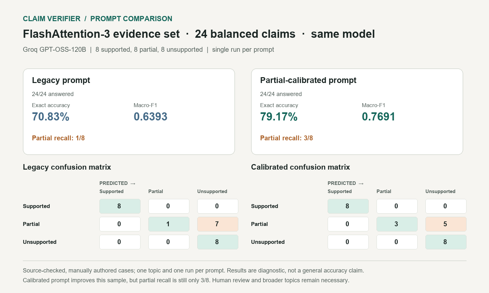

# Claim verifier evaluation

This small comparison measures Ada's claim-support verifier on one public research topic. The benchmark contains 24 manually authored, source-checked claim/evidence pairs, balanced across supported, partial, and unsupported labels. It is a focused engineering diagnostic, not a general-purpose accuracy estimate. Labels and paraphrased evidence have not been independently adjudicated by multiple reviewers.

## Prompt comparison

Both complete runs used `groq/openai/gpt-oss-120b`, the same benchmark, batch size 8, and a single run per prompt. No examples were removed from the denominators.

| Prompt | Answered | Exact accuracy | Macro-F1 | Partial recall | Latency |
| --- | ---: | ---: | ---: | ---: | ---: |
| `legacy-v1` | 24/24 | 70.83% | 0.6393 | 1/8 | 6.72 s |
| `partial-calibrated-v2` | 24/24 | 79.17% | 0.7691 | 3/8 | 7.59 s |

The calibrated prompt improves this sample by 8.34 percentage points in exact accuracy and 0.1298 in macro-F1. Its partial-class recall rises from 12.5% to 37.5%; five of eight partial cases are still labeled unsupported. The result supports iterating on this failure mode, not claiming production-level performance.



## Reproduce

```powershell
$env:LLM_JUDGE_PRIMARY = "groq/openai/gpt-oss-120b"
$env:LANGFUSE_ENABLED = "false"
.\.venv\Scripts\python.exe scripts\evaluate_claim_support.py --prompt-version legacy-v1 --output output\claim-eval-legacy.json
.\.venv\Scripts\python.exe scripts\evaluate_claim_support.py --prompt-version partial-calibrated-v2 --output output\claim-eval-calibrated.json
```

The environment assignments above select the model and keep the recorded comparison independent of Langfuse availability. The runner reports a trace ID, but a trace should be considered present only when `langfuse_health` is `healthy` and it is visible in Langfuse.

## Run records

- `flashattention3-gpt-oss-legacy-v1.json` — complete legacy-prompt run, 24/24 verdicts.
- `flashattention3-gpt-oss-calibrated-v2.json` — complete calibrated-prompt run, 24/24 verdicts.
- `flashattention3-baseline.json` — complete 24/24 run on Qwen with an earlier prompt; not part of the same-model comparison.
- `flashattention3-gpt-oss-calibrated-v2-provider-failure.json` and `flashattention3-calibrated-v2.json` — incomplete provider-degraded attempts. Do not use those files for the prompt comparison above; unanswered outputs remain in their scores rather than being dropped.

The complete comparison was run with Langfuse disabled, so neither run has a confirmed Langfuse trace. At evaluation time the local Langfuse health endpoint was unreachable. An unrelated open trace should not be presented as proof for these evaluation run IDs.

## Sources and limitations

The cases paraphrase content from the [FlashAttention-3 paper](https://arxiv.org/html/2407.08608v1) and [author blog](https://tridao.me/blog/2024/flash3/). The benchmark covers one topic and one run per prompt. Prompt variance, label ambiguity, and this narrow topic limit the conclusions. Add independently reviewed topics and repeat runs before making broader claims.
